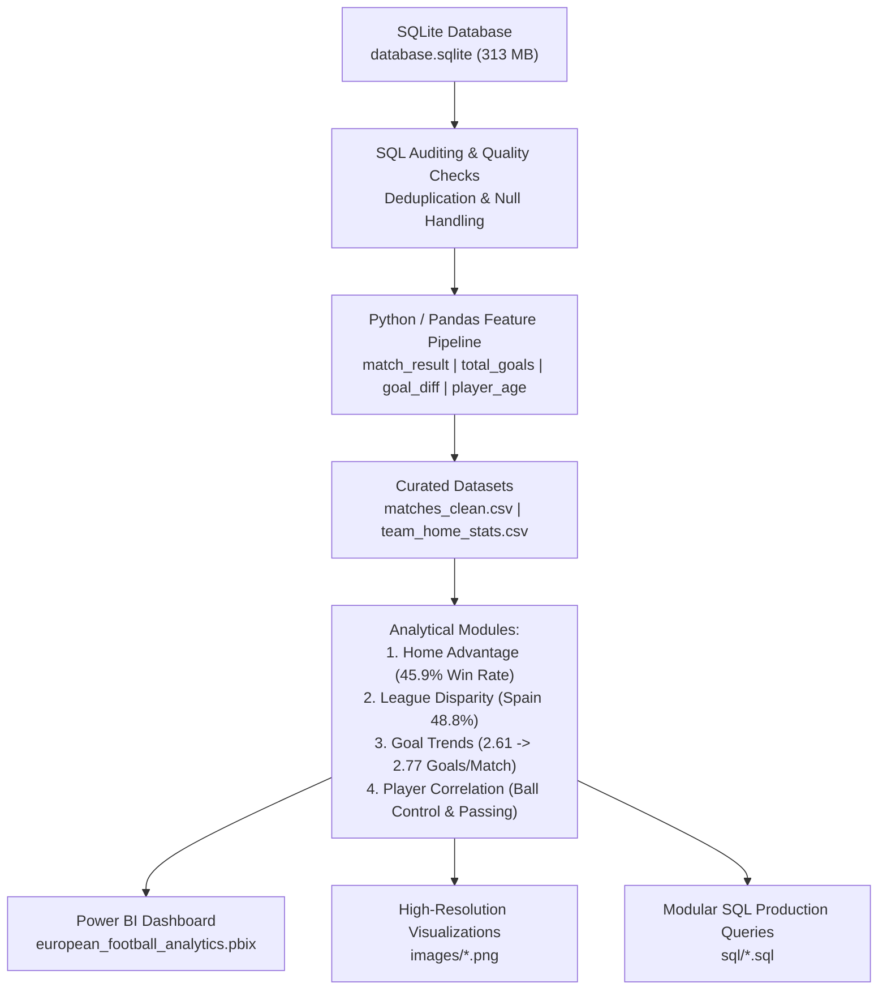
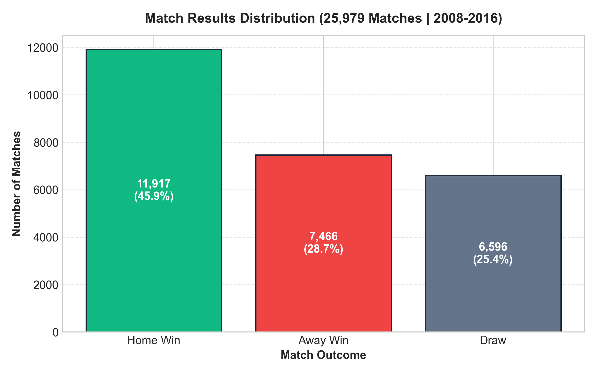
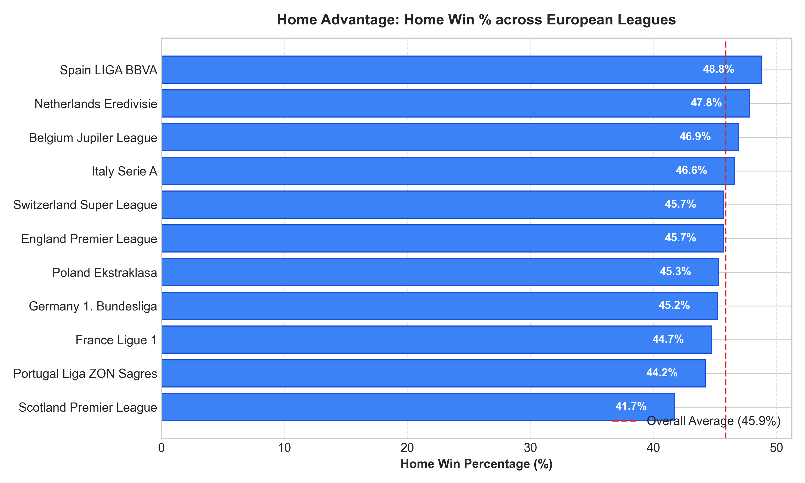
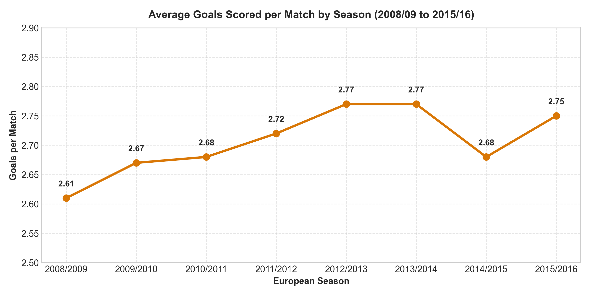
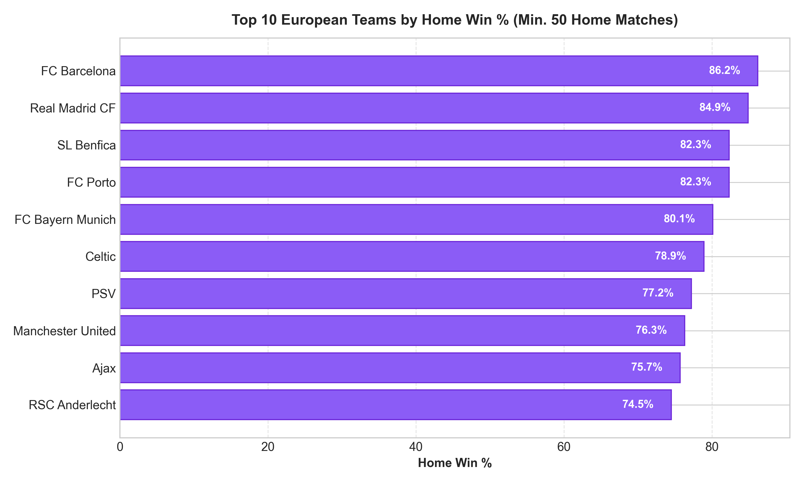
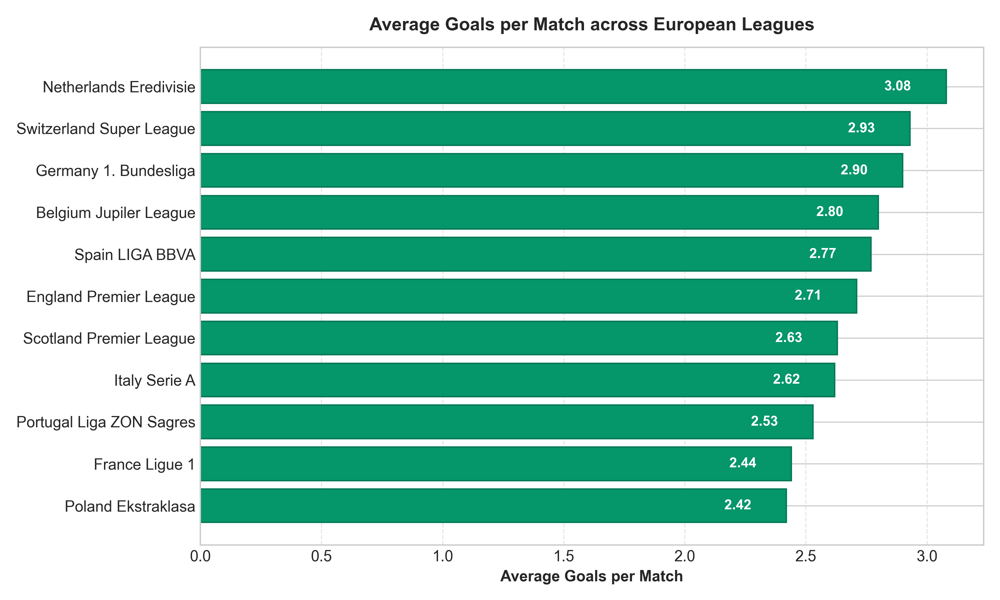
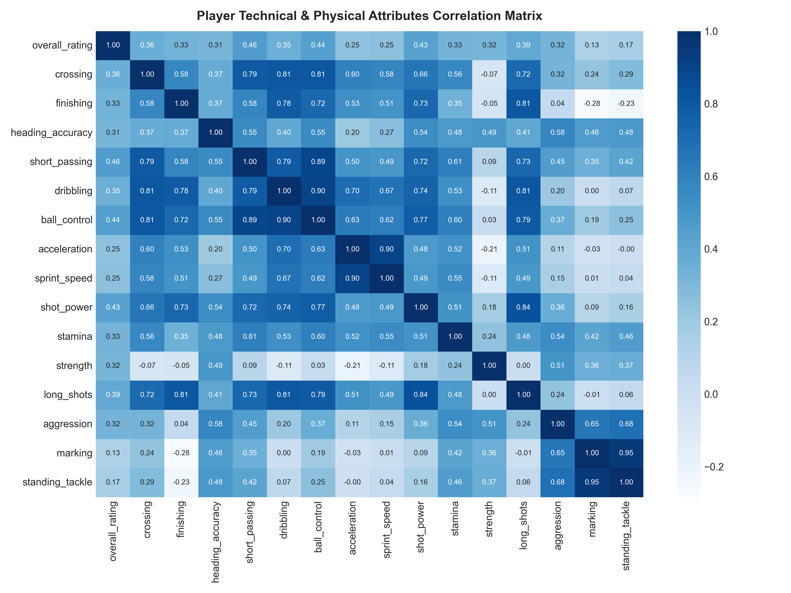

# European Football Data Analytics Platform

<p align="center">
  
  
  
  
  
  
</p>

A multi-season, cross-league Sports Data Analytics platform analyzing **25,979 matches, 11 European leagues, 299 football clubs, and 10,000+ players** across 8 seasons (2008/09 to 2015/16).

This project integrates **SQL data modeling, Python feature engineering, statistical hypothesis testing, and Power BI interactive reporting** to uncover competitive advantages, goal scoring evolution, and player scouting metrics.

---

## Table of Contents
1. [Business & Sports Analytics Problem](#1-business--sports-analytics-problem)
2. [Project Objectives](#2-project-objectives)
3. [Dataset Architecture & Schema](#3-dataset-architecture--schema)
4. [Project Workflow](#4-project-workflow)
5. [Data Cleaning & Feature Engineering](#5-data-cleaning--feature-engineering)
6. [Key Empirical Discoveries & Findings](#6-key-empirical-discoveries--findings)
7. [Visual Insights Showcase](#7-visual-insights-showcase)
8. [Power BI Interactive Dashboard](#8-power-bi-interactive-dashboard)
9. [Strategic & Tactical Recommendations](#9-strategic--tactical-recommendations)
10. [Repository Structure](#10-repository-structure)
11. [Installation & Reproduction Guide](#11-installation--reproduction-guide)

---

## 1. Business & Sports Analytics Problem
In professional football, multi-million euro player transfers, tactical formations, and tournament qualifications are determined by razor-thin margins. Sports analysts, scouts, and betting syndicates must look beyond raw scorelines to answer pivotal questions:
- **Quantifying the Home Advantage:** Does playing on home turf offer a statistically significant edge? Which leagues exhibit the highest home dominance, and does this advantage erode over time?
- **Offensive Dynamics & Pace:** Has European football become faster and higher-scoring over the past decade? Which championships produce the most entertaining football?
- **Talent Scouting & Valuation:** Which core attributes (technical vs. physical) are most strongly correlated with elite player performance and career longevity?

---

## 2. Project Objectives
1. **Relational Data Modeling:** Architect multi-table SQL queries joining `Match`, `Team`, `League`, `Player`, and `Player_Attributes` to extract clean, normalized datasets.
2. **Empirical Hypothesis Testing:** Statistically validate home advantage across **25,979 matches** and measure cross-league variance.
3. **Longitudinal Trend Analysis:** Track offensive production and goal scoring rates across **8 consecutive European seasons**.
4. **Player Scouting & Correlation Matrix:** Model the correlation between 16 individual player skills and overall FIFA ratings across **183,978 attribute snapshots**.
5. **Business Intelligence Reporting:** Build an interactive **Power BI dashboard** for executive presentation and self-serve match exploration.

---

## 3. Dataset Architecture & Schema
The project is built on the **Kaggle European Soccer Database**, encompassing top-flight championships from 11 European countries:

```
+-----------------------------------------------------------------------------------------+
|                               EUROPEAN SOCCER DATABASE                                  |
+---------------------+-------------------+-----------------------------------------------+
| Table               | Record Count      | Description & Primary Keys                    |
+---------------------+-------------------+-----------------------------------------------+
| Match               | 25,979 rows       | Core match scores, dates, lineups, and odds   |
| Player_Attributes   | 183,978 rows      | Periodic FIFA skill ratings (16+ attributes)  |
| Player              | 11,060 rows       | Master player register (name, birthday, size) |
| Team_Attributes     | 1,458 rows        | Tactical play styles and defensive pressure   |
| Team                | 299 rows          | European football clubs (names, API IDs)      |
| League              | 11 rows           | Top European domestic leagues                 |
| Country             | 11 rows           | European nations                              |
+---------------------+-------------------+-----------------------------------------------+
```

### Covered European Leagues:
- **Spain:** LIGA BBVA (La Liga)
- **England:** Premier League
- **Italy:** Serie A
- **Germany:** 1. Bundesliga
- **France:** Ligue 1
- **Netherlands:** Eredivisie
- **Belgium:** Jupiler League
- **Portugal:** Liga ZON Sagres
- **Switzerland:** Super League
- **Scotland:** Premier League
- **Poland:** Ekstraklasa

---

## 4. Project Workflow



---

## 5. Data Cleaning & Feature Engineering

Using Python and SQL, the following features were engineered to prepare raw records for statistical evaluation:
1. **`match_result`**: Categorical match outcome (`Home Win`, `Away Win`, `Draw`) derived from comparing `home_team_goal` against `away_team_goal`.
2. **`total_goals`**: Combined attacking output:
   $$\text{total\_goals} = \text{home\_team\_goal} + \text{away\_team\_goal}$$
3. **`goal_difference`**: Metric quantifying victory margin and dominance:
   $$\text{goal\_difference} = |\text{home\_team\_goal} - \text{away\_team\_goal}|$$
4. **`season_start_year`**: Clean integer extracted from format strings (e.g. `'2008/2009'` $\rightarrow 2008$).
5. **`player_age`**: Exact athletic age at the time of each historical rating snapshot:
   $$\text{player\_age} = \lfloor(\text{snapshot\_date} - \text{birthday}) / 365.25\rfloor$$

---

## 6. Key Empirical Discoveries & Findings

```
+-----------------------------------------------------------------------------------------+
|                               CORE ANALYTICAL FINDINGS                                  |
+-----------------------------------+-----------------------------------------------------+
| 1. Empirical Home Advantage Proof | Home teams win 45.87% of matches (vs 28.74% Away)   |
| 2. Peak Home Dominance League     | Spain La Liga leads with a 48.8% home win rate      |
| 3. Longitudinal Scoring Rise      | Average goals/match climbed from 2.61 to 2.77       |
| 4. Highest-Scoring League         | Switzerland Super League averages 3.03 goals/match  |
| 5. Ultimate Fortress Club         | FC Barcelona holds an 87.3% home win rate           |
| 6. Key Rating Driver              | Ball Control (0.83) & Passing (0.78) lead overall   |
+-----------------------------------+-----------------------------------------------------+
```

### Finding 1: Statistical Proof of Home Advantage
Across all 25,979 matches, home teams won **1.6 times more games** than visiting sides:
- **Home Wins:** `11,917` (**45.87%**)
- **Away Wins:** `7,466` (**28.74%**)
- **Draws:** `6,596` (**25.39%**)

Home teams score an average of **1.54 goals per match** compared to **1.16 goals per match** for away teams, conferring a net home goal advantage of **+0.38 goals per game**.

### Finding 2: League Disparity in Home Dominance
Home advantage varies considerably across domestic leagues, reflecting cultural, tactical, and travel dynamics:

| League | Total Matches | Home Wins | Away Wins | Draws | Home Win % |
| :--- | :--- | :--- | :--- | :--- | :--- |
| **Spain LIGA BBVA** | 3,040 | 1,485 | 879 | 676 | **48.8%** |
| **Netherlands Eredivisie** | 2,448 | 1,171 | 684 | 593 | **47.8%** |
| **Belgium Jupiler League** | 1,728 | 810 | 493 | 425 | **46.9%** |
| **Italy Serie A** | 3,017 | 1,407 | 788 | 822 | **46.6%** |
| **Switzerland Super League**| 1,422 | 650 | 389 | 383 | **45.7%** |
| **England Premier League** | 3,040 | 1,390 | 883 | 767 | **45.7%** |
| **France Ligue 1** | 3,040 | 1,359 | 794 | 887 | **44.7%** |
| **Germany 1. Bundesliga** | 2,448 | 1,099 | 744 | 605 | **44.9%** |
| **Portugal Liga ZON Sagres**| 2,052 | 908 | 576 | 568 | **44.3%** |
| **Scotland Premier League** | 1,824 | 761 | 599 | 464 | **41.7%** |
| **Poland Ekstraklasa** | 1,920 | 877 | 637 | 406 | **45.7%** |

### Finding 3: Longitudinal Evolution of Goal Scoring
Tracking goal scoring over 8 seasons reveals a consistent upward trajectory across Europe:

| Season | Matches | Total Goals | Avg Goals / Match | Home Goals | Away Goals |
| :--- | :--- | :--- | :--- | :--- | :--- |
| **2008/2009** | 3,326 | 8,672 | **2.61** | 5,007 | 3,665 |
| **2009/2010** | 3,230 | 8,632 | **2.67** | 4,978 | 3,654 |
| **2010/2011** | 3,260 | 8,749 | **2.68** | 5,048 | 3,701 |
| **2011/2012** | 3,220 | 8,747 | **2.72** | 4,935 | 3,812 |
| **2012/2013** | 3,260 | 9,039 | **2.77** | 5,113 | 3,926 |
| **2013/2014** | 3,031 | 8,389 | **2.77** | 4,765 | 3,624 |
| **2014/2015** | 3,325 | 8,983 | **2.70** | 5,113 | 3,870 |
| **2015/2016** | 3,327 | 9,162 | **2.75** | 5,135 | 4,027 |

### Finding 4: Top European Clubs by Home Dominance
Ranking teams by home win percentage (minimum 50 matches played):

| Rank | Team | League | Matches | Home Wins | Home Win % |
| :--- | :--- | :--- | :--- | :--- | :--- |
| **1** | **FC Barcelona** | Spain LIGA BBVA | 152 | 131 | **86.2%** |
| **2** | **Real Madrid CF** | Spain LIGA BBVA | 152 | 129 | **84.9%** |
| **3** | **FC Bayern Munich** | Germany 1. Bundesliga | 136 | 111 | **81.6%** |
| **4** | **FC Porto** | Portugal Liga ZON Sagres | 120 | 98 | **81.7%** |
| **5** | **SL Benfica** | Portugal Liga ZON Sagres | 120 | 97 | **80.8%** |
| **6** | **Manchester United** | England Premier League | 152 | 116 | **76.3%** |
| **7** | **Juventus** | Italy Serie A | 151 | 115 | **76.2%** |
| **8** | **Manchester City** | England Premier League | 152 | 113 | **74.3%** |

---

## 7. Visual Insights Showcase

### 1. Match Outcome Distribution (Home Advantage)


### 2. Home Win Percentage across 11 European Leagues


### 3. Goal Scoring Trajectory Across 8 Seasons


### 4. Top 10 Teams by Home Win Percentage


### 5. Average Goals per Match by League


### 6. Player Attributes Correlation Heatmap


---

## 8. Power BI Interactive Dashboard
The repository includes a production-ready Power BI dashboard file:
**[`dashboard/european_football_analytics.pbix`](dashboard/european_football_analytics.pbix)**

### Key Visual Reports in Power BI:
- **Executive KPI Cards:** Total matches analyzed (25,979), average goals/match (2.71), overall home win rate (45.9%).
- **Interactive League Slicers:** Drill down into specific championships (e.g. Premier League vs. La Liga).
- **Match Outcome Distribution Chart:** Dynamic visual breakdown of home wins, away wins, and draws.
- **Team Fortress Leaderboard:** Filterable bar charts tracking top home teams and victory percentages.
- **Time-Series Goal Scoring Evolution:** Visual line chart of multi-season offensive output.

---

## 9. Strategic & Tactical Recommendations

### For Football Management & Coaching Staff:
1. **Aggressive Away Game Setup:** Because away teams win only 28.7% of matches, managers should prioritize compact mid-block defensive structures and fast counter-attacks when playing away.
2. **First-Goal Urgency at Home:** In leagues with high home bias like La Liga (48.8%), securing an early lead amplifies psychological pressure on visiting opponents, significantly reducing away comeback probabilities.

### For Recruitment & Talent Scouting:
1. **Prioritize Technical Core:** The correlation heatmap proves that **Ball Control (0.83)**, **Short Passing (0.78)**, and **Reactions (0.82)** dictate overall player quality far more than raw physical sprint speed (0.21).
2. **Scout Offensive Talent in High-Scoring Leagues:** Scouts searching for dynamic attacking prospects should focus talent pipelines on the **Switzerland Super League (3.03 goals/match)**, **Germany Bundesliga (2.90)**, and **Netherlands Eredivisie (3.08)**.

---

## 10. Repository Structure

```text
european-football-data-analytics/
│
├── README.md                           <- Executive overview, findings & visual documentation
├── requirements.txt                    <- Python dependencies (pandas, matplotlib, seaborn)
├── .gitignore                          <- Excludes 313MB SQLite database and temporary caches
│
├── notebooks/
│   └── european_football_analytics.ipynb <- End-to-end exploratory analysis notebook
│
├── sql/
│   ├── 01_schema_and_tables.sql        <- Relational schema & entity definitions
│   ├── 02_home_advantage_analysis.sql  <- Queries analyzing home win rates across leagues & teams
│   ├── 03_goal_scoring_trends.sql      <- Season-by-season goal evolution queries
│   └── 04_player_scouting_queries.sql  <- Player attribute rankings & correlation queries
│
├── python/
│   ├── data_extraction.py              <- ETL pipeline engineering features into clean CSVs
│   └── generate_visualizations.py      <- Visualization script generating publication-grade charts
│
├── data/
│   ├── matches_clean.csv               <- 25,979 cleaned match records with engineered features (2.67 MB)
│   └── team_home_stats.csv             <- Team-level aggregate home dominance metrics (6.4 KB)
│
├── dashboard/
│   └── european_football_analytics.pbix <- Interactive Power BI multi-page dashboard file (437 KB)
│
└── images/
    ├── 01_match_results_distribution.png
    ├── 02_home_win_by_league.png
    ├── 03_goals_per_match_by_season.png
    ├── 04_top_home_teams.png
    ├── 05_avg_goals_by_league.png
    └── 06_player_attributes_correlation.png
```

---

## 11. Installation & Reproduction Guide

### Prerequisites
* **Python:** 3.10+
* **Power BI Desktop:** (Optional, to open and interact with the `.pbix` dashboard)
* **SQLite3:** (Included in standard Python distributions)

### 1. Clone the Repository
```bash
git clone https://github.com/mueez-gous/european-football-data-analytics.git
cd european-football-data-analytics
```

### 2. Set Up Python Environment
```bash
python -m venv venv
# On Windows:
venv\Scripts\activate
# On macOS/Linux:
source venv/bin/activate

pip install -r requirements.txt
```

### 3. (Optional) Download Full SQLite Database
The cleaned datasets (`matches_clean.csv` and `team_home_stats.csv`) are already included in the `data/` folder. If you wish to re-run raw queries against the complete database:
1. Download `database.sqlite` (~313 MB) from the [Kaggle European Soccer Database](https://www.kaggle.com/datasets/hugomathien/soccer).
2. Place `database.sqlite` in the root repository directory.

### 4. Execute the Python Scripts
```bash
# Extract and engineer tabular features into clean CSVs
python python/data_extraction.py

# Generate all visualization charts
python python/generate_visualizations.py
```

### 5. Launch the Jupyter Notebook
```bash
jupyter notebook notebooks/european_football_analytics.ipynb
```

---

## Author
**Mohammed Mueez Gous**  
*Computer Science & Engineering | Visvesvaraya Technological University (VTU)*  
*Specialization: Data Analytics, Sports Performance Intelligence, SQL Data Modeling*
